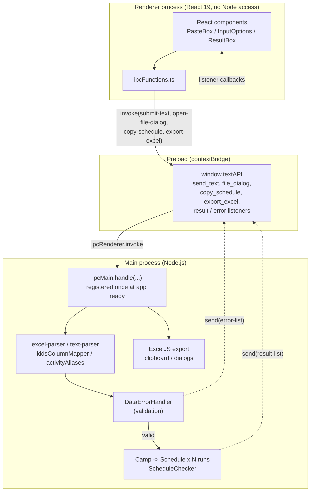
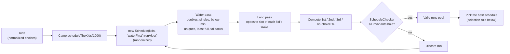

# NY Sheriff Summer Camp Scheduler

> A desktop app that turns a spreadsheet of camper preferences into a complete activity schedule in seconds, giving as many kids as possible one of their top three choices.

[](https://github.com/Darren-Haynes/NY-Sheriff-Summer-Camp-Scheduler/actions/workflows/ci.yml)
[](https://codecov.io/gh/Darren-Haynes/NY-Sheriff-Summer-Camp-Scheduler)
[](https://github.com/Darren-Haynes/NY-Sheriff-Summer-Camp-Scheduler/releases/latest)


The New York State Sheriffs' Institute runs a summer camp for up to 146 kids. Each camper ranks three **water** activities and three **land** activities. Volunteers used to match them to 9am and 10am slots by hand, while respecting minimum and maximum group sizes for every activity.

This app automates that. A volunteer loads an `.xlsx` file (or pastes rows from a spreadsheet). The app validates the data, runs a randomized scheduling algorithm up to 1,000 times, and keeps the best valid result. The schedule can be copied to the clipboard or exported to a two-sheet Excel workbook (*By Activity* and *By Name*).

It is my first large software project. The scheduling engine, parsers and validation are my own work. I used AI assistance for much of the test suite and the CI pipeline, and I reviewed and ran all of it.

**Highlights**

- A constraint-based scheduling engine with an independent checker that verifies every candidate schedule
- On the rosters I measured, **87-99% of kids get one of their top three choices** (details and caveats in [How good are the schedules?](#how-good-are-the-schedules))
- Two real-world spreadsheet layouts plus pasted text, with tolerant header and activity-name matching
- Human-readable validation errors that point at the offending row and column
- Unit, integration (including fuzzing) and Playwright end-to-end tests against the packaged app, at ~98% coverage of the main process
- Tag-driven release pipeline that builds Windows, macOS and Linux installers and publishes them with SHA-256 checksums

---

## Download

Installers for each release are on the [Releases page](https://github.com/Darren-Haynes/NY-Sheriff-Summer-Camp-Scheduler/releases/latest).

| Platform | File | Verified on |
|---|---|---|
| Windows 11 (x64) | `.msi` | Windows 11 |
| macOS (Apple Silicon) | `.dmg` or `.zip` | macOS on an M-series Mac |
| Linux (x64), Fedora / RHEL | `.rpm` | Fedora |
| Linux (x64), Debian / Ubuntu | `.deb` | Built by the same pipeline, not yet installed on a Debian-based system |

The Windows and macOS installers are **not signed with a paid certificate**, so those systems warn on first launch. Step-by-step instructions are in the release notes and in [`docs/RELEASING.md`](docs/RELEASING.md). Every release includes `SHA256SUMS.txt` so downloads can be verified.

---

## Screenshots / Demo

*A demo GIF is coming: load a roster, view the schedule and choice statistics, export to Excel.*

<!-- When docs/demo.gif exists, replace the line above with:  -->

---

## Architecture Overview

The app follows Electron's recommended three-part split. The **renderer** is a React UI with no Node access (`contextIsolation: true`, `nodeIntegration: false`). The **preload** script exposes a small API (`window.textAPI`) through `contextBridge`. The **main** process owns the filesystem, native dialogs, the clipboard and all scheduling logic.



### Request flow

1. The user pastes text or picks an `.xlsx` file. The renderer calls `window.textAPI.send_text(...)` or `file_dialog()`.
2. The preload script forwards the call with `ipcRenderer.invoke`, and the main process handles it.
3. The main process **normalizes** the input to a uniform `[first, last, L1, L2, L3, W1, W2, W3]` row shape, whichever format it arrived in.
4. `DataErrorHandler` validates the data: unknown activities, duplicate names, and roster size (50 to 146 kids).
5. On failure, the main process sends an `error-list` message with row-level details. On success, `Camp` runs the scheduling algorithm and sends a `result-list` message.
6. The renderer subscribes to these channels in `MainContent.tsx` and switches between the error view and the result view.

Handlers find the window that sent a request through `BrowserWindow.fromWebContents(event.sender)` and are registered once at startup. Registering them inside `createWindow()` threw "Attempted to register a second handler" when a macOS user closed the window and clicked the dock icon. I reproduced that on a real Mac, fixed it, and added a regression test.

### Scheduling engine



Each kid gets one water activity and one land activity, and the two must fall in *opposite* time slots (water at 9am means land at 10am). Every activity has a minimum and maximum group size, and some run in only one slot.

The algorithm is a **randomized multi-phase greedy heuristic with random restarts**. When an activity has more takers than spots, the kids who are moved or dropped are chosen at random, so no camper is favored or penalized by name or by position in the list. Each finished run is validated by an independent `ScheduleChecker`, and only valid runs are eligible to be chosen.

**How the best run is chosen** (`Camp.bestPercentagesSchedule`):

1. The run with the lowest combined water + land **no-choice** percentage wins. Water and land count equally, and a missed water choice is no worse than a missed land choice.
2. Ties go to the run with the most first choices.

This is deliberate. A schedule where every kid gets a top-three pick beats one where 90% get their first choice and 10% get nothing. The rule is covered by unit tests in `test/unit/camp-best-schedule.test.ts`.

**Why water goes first.** Every water activity runs in both the 9am and 10am slots, and the group-size maximums cap water at 73 kids per slot, so **146 is the hard capacity of the whole camp**. Land has more room (80 kids at 9am, 86 at 10am). Water is the binding constraint, so the algorithm schedules it first and fits land around it. A typical roster is about 100 kids. 146 is the ceiling, not the norm. I considered running a land-first pass as well and comparing the two. It needs a large rewrite of the engine, and I don't know yet whether it would change the results much, so it is a possible future experiment and not part of this release.

---

## How good are the schedules?

I measured it instead of eyeballing a few runs. For each roster I ran the full app logic (1,000 randomized attempts, best valid run kept) **10 times with real randomness**, and counted each kid's actual water and land result from the finished schedule. The table shows the average over those 10 runs.

| Roster | Kids | Water: top 3 | Land: top 3 | Water: 1st | Land: 1st |
|---|---|---|---|---|---|
| Even demand | 50 | 99.4% | 88.2% | 50% | 35% |
| Even demand | 94 | 99.4% | 93.5% | 53% | 51% |
| Even demand | 114 | 97.7% | 92.8% | 88% | 58% |
| Even demand, **maximum camp size** | 146 | 94.2% | 87.2% | 71% | 59% |

("Top 3" means the kid got their first, second or third choice. "1st" means their first choice.)

**What I take from this**

- **The main goal is met.** On these rosters 87-99% of kids get a top-three choice in both water and land, and at realistic sizes (about 100 kids) it is 93-99%. The 146-kid roster is a full camp with every spot taken, and it still keeps about 87-94%.
- **The 1,000-run search matters.** A typical single valid run leaves about 10-16% of kids with no choice (averaged over water and land). Keeping the best of 1,000 brings that to about 3-9%, which is roughly 40-65% fewer unhappy kids. Each result is also consistent from run to run: the 94-kid roster stayed at 98-100% water and 93-95% land over 10 repetitions.
- **Impossible rosters hit the theoretical limit.** I also test deliberately hostile data. When all 145 kids put canoe for all three water choices, only 20 can ever get it (canoe's capacity across both slots), and the app gives exactly 20. When every kid wants football on land, only 12 spots exist, and the app gives exactly 12. In those cases the "no choice" share is set by the activity limits, not by the algorithm. These rosters are part of the integration suite, which checks that the schedule is valid and that the best run was chosen, not these exact percentages.

**Honest caveats**

- **First choices are the weaker number.** The selection rule prioritizes "nobody left out" over "most first choices", so the first-choice share is only a tie-breaker, and it varies a lot between rosters (50-88% for water). Comparing against a simple per-activity capacity limit suggests there may be room to improve it on some rosters. I haven't tested that.
- **These rosters are synthetic and fairly evenly spread.** Real camper preferences are usually more clustered around popular activities. A skewed 104-kid test roster (39 kids picking swim first for water) still got 100% water top-three, but that is one data point, not a guarantee.
- **The result is random.** Running again can change the numbers by a few percent, mostly on full or nearly full camps.
- **I have no baseline against the hand-built schedules** the volunteers made before, so I make no claim about how much better the app is than that.

---

## Key Technical Decisions

| Decision | Rationale |
|---|---|
| **Electron** | The users are volunteers on ordinary laptops with no IT support. A double-click installer, native file dialogs, clipboard access and offline use matter more than a hosted web app. Camper names also stay on the local machine and never reach a server, which suits data about minors. |
| **TypeScript everywhere** | The scheduler manipulates many parallel structures keyed by activity and time slot. Branded and union types (`Int`, `WaterActivities`, `LandActivities9am`, ...) catch whole classes of slot and activity mix-ups at compile time. |
| **Electron Forge + Webpack** | One tool for the dev server, packaging and installers. The Webpack config is test-aware: it swaps `ts-loader` for `babel-loader` + `babel-plugin-istanbul` so renderer coverage can be collected from the packaged app. |
| **Randomized search over one deterministic pass** | Group-size minimums and maximums make a single greedy pass brittle. Many cheap randomized attempts, each independently verified, reliably find a feasible schedule, and keeping the best one measurably reduces the number of kids with no choice (see above). |
| **Random selection, not list order** | When an activity is oversubscribed, someone has to be moved. Choosing who at random (a Fisher-Yates selection, so every kid has an equal chance), instead of by name or position, removes alphabetical and list-order bias. Unit tests check that kids at the start of a long list are not favored. |
| **Tolerant input handling** | Real spreadsheets are messy. Columns are found by header keyword (any order), the right worksheet is auto-detected in multi-sheet workbooks, and aliases such as `football`, `hiking` and `arts & crafts` map to canonical codes. Anything unrecognized is *rejected with a precise message*, never guessed. |
| **Vitest for logic, Playwright for the shell** | Fast, deterministic unit and integration tests cover the engine. Playwright drives the real packaged Electron app. |
| **Security posture** | `contextIsolation: true`, `nodeIntegration: false`, a narrow `contextBridge` surface, and Electron Fuses (`RunAsNode` off, `OnlyLoadAppFromAsar` on, Node CLI inspect and `NODE_OPTIONS` disabled). |

---

## Project Structure

```text
.
├── .github/workflows/
│   ├── ci.yml                    # Lint, typecheck, unit + integration + e2e tests, coverage upload
│   └── release.yml               # Tag-driven build of installers for 3 OSes, publish with checksums
├── assets/                       # Logos, icons (.ico, .icns), and background photos
├── docs/RELEASING.md             # How a release is cut, and what users see on first launch
├── scripts/
│   ├── excel-to-TS-array.ts      # Turns a spreadsheet of test rosters into typed TS fixtures
│   └── make-macos-icon.py        # Generates the macOS .icns from the source artwork
├── src/
│   ├── main/                     # Electron main process (Node.js)
│   │   ├── main.ts               # Window creation, IPC handlers, Excel export
│   │   ├── preload.ts            # contextBridge API exposed as window.textAPI
│   │   ├── excel-parser.ts       # .xlsx -> normalized rows (auto-detects the right sheet)
│   │   ├── text-parser.ts        # Pasted text -> normalized rows (header or legacy layout)
│   │   ├── kidsColumnMapper.ts   # Header-keyword column detection shared by both parsers
│   │   ├── activityAliases.ts    # "football" -> "fball", "hiking" -> "hike", ...
│   │   ├── dataInput.ts          # DataErrorHandler: row-level validation and messages
│   │   ├── activities.ts         # Activity catalog: slots, min/max group sizes, capacity notes
│   │   ├── kids.ts               # Camper model built from normalized rows
│   │   ├── camp.ts               # Runs N randomized attempts and selects the best
│   │   ├── schedule.ts           # The scheduling algorithm (one randomized run)
│   │   ├── schedule-checker.ts   # Independent verification of a finished schedule
│   │   └── scheduler-utils.ts    # Shared helpers
│   ├── renderer/                 # React UI (no Node access)
│   │   ├── App.tsx / MainContent.tsx   # Top-level view state, IPC subscriptions
│   │   ├── PasteBox.tsx, InputOptions.tsx, ErrorBox.tsx, ResultBox.tsx
│   │   ├── Schedule.tsx, Stats.tsx, timeSlots.tsx   # Schedule and choice-statistics views
│   │   └── ipcFunctions.ts       # Thin wrappers over window.textAPI
│   └── types/                    # Shared domain types (Int, activities, time slots, ...)
├── test/
│   ├── unit/                     # Parsers, validation, selection rule, percentages, randomness
│   ├── integration/              # Full scheduling runs on realistic and worst-case rosters, fuzzing
│   ├── helpers/seeded-random.ts  # Deterministic randomness for reproducible test runs
│   └── e2e/                      # Playwright tests driving the packaged Electron app
│       └── fixtures/             # .xlsx rosters (success and error cases, two formats)
├── forge.config.ts               # Packaging, makers (MSI, DMG, ZIP, DEB, RPM), Electron Fuses
├── webpack.{main,renderer}.config.ts   # Test-aware build config (Babel + Istanbul in test)
├── vitest.config.ts              # Vitest + V8 coverage
├── playwright.config.ts          # E2E configuration
└── codecov.yml                   # Separate Codecov flags for main and renderer
```

---

## Quality Highlights

### Testing

| Layer | Tooling | What it covers |
|---|---|---|
| **Unit** | Vitest | Excel and text parsers, header detection, aliases, validation rules, activity ranges, the best-schedule selection rule, percentage rounding, randomness fairness |
| **Integration** (74 Vitest tests in total, unit + integration) | Vitest | Full `Camp` runs on rosters from 50 to 146 kids, including worst cases such as every kid choosing canoe or football first. A **fuzz test** sweeps every roster size from 50 to 150 with deliberately duplicated choices to exercise rounding and fallback branches. |
| **End-to-end** (42 tests) | Playwright (`_electron`) | Launches the *packaged* app and drives it like a user: file upload, paste box, a matrix of valid and invalid Excel files in both formats, cancelled dialogs, responsive layout, and re-opening the window after closing it |

- **Self-verifying algorithm.** After each run, `ScheduleChecker` recounts the finished schedule from scratch and cross-checks it against the algorithm's own bookkeeping: every kid is scheduled once per activity type, no activity is under its minimum, percentages add up, and each kid's water and land slots are opposite. A run that fails is thrown away.
- **Deterministic randomness.** Tests use a seeded generator (`test/helpers/seeded-random.ts`) so randomized code is reproducible in CI without being pinned to a constant.
- **Flaky tests are fixed, not retried.** An intermittent end-to-end failure (3 failures in 30 runs) was traced to a test that polled the app while its main process was busy scheduling. It was reworked, and I confirmed 0 failures in 90 consecutive runs against 3 in 30 before.
- **Split coverage.** Main-process coverage (about 98% of statements) comes from Vitest (V8). Renderer coverage comes from the Playwright run, with `babel-plugin-istanbul` instrumenting the packaged build. Each is uploaded to Codecov under its own flag.

### Linting and types

- ESLint 10 flat config with `typescript-eslint` and `import-x/no-unresolved`; Prettier configuration included
- TypeScript with `noImplicitAny` and `strictNullChecks`
- Webpack's `ts-loader` runs with `transpileOnly`, so it never reports type errors. CI therefore runs `tsc --noEmit` (app and tests) as its own step, which is the only place type errors can fail a build.

### CI/CD

**CI** (`.github/workflows/ci.yml`) runs on every push and pull request:

1. Lint and typecheck as a fast first job
2. Vitest with coverage
3. Package the Electron app with the test instrumentation flag
4. Run the Playwright suite under `xvfb` (headless Linux)
5. Upload the Playwright HTML report as an artifact (kept even when tests fail)
6. Upload both coverage reports to Codecov and fail the build if the upload fails

**Release** (`.github/workflows/release.yml`) runs when a `v*` tag is pushed:

1. Verify the tag matches the version in `package.json`
2. Build installers in parallel on Windows, macOS and Linux runners
3. Publish a GitHub Release with every installer and a `SHA256SUMS.txt`; tags with a hyphen (`v1.1.0-rc.1`) become pre-releases

The same build jobs also run on pull requests that touch the workflow or `forge.config.ts`, so a broken release pipeline is caught before it reaches `main`. The pipeline surfaced real packaging bugs that I fixed before release: a macOS DMG volume-name length limit, a Linux binary-name mismatch, and a stale macOS code signature that made the app appear "damaged". See [`docs/RELEASING.md`](docs/RELEASING.md).

### Known trade-offs

- `schedule.ts` is a large single class (~2,500 lines), built up against a growing set of real-world rosters. The integration suite is what makes refactoring it safe, and splitting it into per-phase modules is the natural next step.
- Scheduling runs on the main process and can freeze the window for 1-2 seconds on hard, full-size rosters.
- Windows and macOS installers are not signed with a paid certificate (macOS carries a free ad-hoc signature).
- First-choice optimization is secondary to the "no kid left out" rule by design (see [How good are the schedules?](#how-good-are-the-schedules)).

---

## Getting Started

### Prerequisites

- **Node.js 24** (see `.nvmrc`; `nvm use` picks it up) and npm
- On Linux, `rpm` and `dpkg`/`fakeroot` tooling if you want to build `.rpm` and `.deb` packages locally

### Install and run

```bash
git clone https://github.com/Darren-Haynes/NY-Sheriff-Summer-Camp-Scheduler.git
cd NY-Sheriff-Summer-Camp-Scheduler
npm ci --legacy-peer-deps   # the same flags CI uses
npm start                   # launch the app with hot reload via Electron Forge
```

Set `DEBUG_DEVTOOLS=true` before launching to enable the `Ctrl/Cmd+Alt+I` DevTools shortcut in a packaged build.

### Input format

Provide data as an `.xlsx` file, or paste rows into the paste box. The header row needs columns for first name, last name, and the six choices (`L1`-`L3` for land, `W1`-`W3` for water). Columns can be in any order. Pasted text with no header is read as the legacy layout: last name, first name, grade, `L1`-`L3`, `W1`-`W3`.

| Type | Activity codes |
|---|---|
| **Water** | `fish`, `pboard`, `snork`, `canoe`, `kayak`, `sail`, `swim` |
| **Land** | `fris`, `art`, `hike`, `pball`, `bball`, `cheer`, `fball`, `lax`, `soc`, `vball`, `yoga`, `arch` |

Common spelled-out names (for example `football`, `hiking`, `lacrosse`) are accepted and normalized. The roster must contain **50 to 146 kids**.

### Scripts

| Command | Description |
|---|---|
| `npm start` | Run the app in development |
| `npm run lint` | Lint the codebase |
| `npm run typecheck` | Typecheck the app and the tests |
| `npm run test:vitest` | Unit and integration tests |
| `npm run test:coverage` | Unit and integration tests with coverage |
| `npm run test:e2e` | Package an instrumented build, run Playwright, and report renderer coverage |
| `npm test` | Full suite: coverage run, then end-to-end |
| `npm run make` | Build installers for the current operating system |

The first end-to-end run needs the Playwright browsers: `npx playwright install --with-deps`. On headless Linux, run Playwright under `xvfb-run` as CI does. The large-roster integration tests take about 30 seconds.

---

## License

Copyright © 2026 New York State Sheriffs' Institute. All rights reserved. See [LICENSE](LICENSE).
